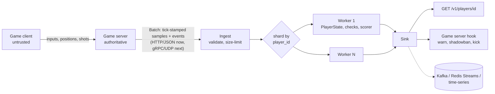

# argus

**Server-authoritative anti-cheat for multiplayer shooters, as an open standard.** No kernel driver, no client
scanning: the game server streams what it *observed* about each player (tick-stamped positions, view angles, shots,
hits, occlusion), and argus validates that stream against the game's own physics and weapon rules, in near real
time, and scores every player with a confidence. Aimbots, silent aim, speed hacks, teleports, fly hacks, no-clip,
wallhack tracking, impossible fire rates, reload and magazine tampering, invented weapons and damage.

Any game plugs in with a config file: tick rate, speeds, weapon profiles, penalty thresholds. The reference service
is Go, standard library only, and the heuristics are pure functions you can read in an afternoon.

```
go run ./cmd/acd -config config/anticheat.config.json
```

## Why

Cheats end small games. A revived or indie shooter cannot ship a kernel-mode driver, cannot afford a vendor, and
still faces the same aimbots as a AAA title. What it *does* have is the one vantage point a cheater cannot patch:
the server. Everything a client claims (where it is, where it aims, what it hit) can be checked against what the
server knows is possible. argus is that check, factored out of any one game so it can be shared, audited and tuned
in the open.

## Architecture



**The trust boundary.** The client is the thing under test, so nothing in a `Batch` comes from it unverified:

| In the batch | Produced by | Never |
|---|---|---|
| `tick` on every sample and event | the game server's clock | client timestamps (dt comes from tick deltas) |
| positions, view angles | what the server relayed/accepted that tick | a client-side "velocity" field |
| hit `origin`, `impact`, `damage` | the server's hit registration | the client's claimed distance |
| `contacts[].visible`, `target_visible_since` | the server's occlusion test | the client's render state |
| `flags` (vehicle, gliding, teleport, dead) | server state | client-declared state |

A client that can post its own telemetry can post a clean one, so the ingest port is for the game server only
(private network or mTLS at the proxy).

**The pipeline.** `Submit` validates (player id, size cap, sort by tick) and hashes `player_id` onto one of N
worker shards. A shard owns its players' `PlayerState` and `Scorer`, so every state machine (reload, magazine,
snap-then-fire) runs lock-free and in order. Scaling out is the same hash across processes: one Kafka partition or
Redis Stream per shard, one engine per consumer. Verdicts go to a `Sink` (in-memory for the read API, a logger, your
message bus, the game server's ban hook).

## The checks

All limits come from the config and get `tolerance` slack. `excess(x, L) = clamp((x - L)/L, 0, 1)` is the
confidence of a limit check: 0 at the limit, 1 at twice it. Deterministic checks (what the config makes physically
impossible) carry heavy weights; statistical ones light, so a penalty needs a pattern of them.

### Kinematics (`pkg/heuristics/movement.go`)

For consecutive samples, `dt = Δtick / tick_rate`, `Δ = p₁ − p₀`, horizontal and vertical apart (a fall is fast
and legal, a sprint is slow):

| Check | Rule | Catches |
|---|---|---|
| `movement.teleport` | `|Δxz| > teleport_factor · v_max · dt` in one step | teleport, position spoofing |
| `movement.speed` | `|Δxz|/dt > v_max (1+tol)` for `min_violations` steps in a row (`v_max` by state: foot, vehicle, glider) | speed hack |
| `movement.vertical` | `Δy/dt > max_rise_velocity` on foot, or `< −max_fall_velocity` | fly hack, falling through the floor |
| `movement.acceleration` | `(v₁ − v₀)/dt > acceleration_threshold`, speeding up only (braking may be instant) | a hack toggled mid-run |
| `movement.noclip` | `World.Blocked(p₀, p₁)` (your map's raycast, optional) | no-clip |

A `FlagTeleport` sample (spawn, respawn, knockback, taxi drop), a `FlagDead`/`FlagSpectating` one, or a silence
longer than `max_gap_ticks` (reconnect) resets the history instead of being judged.

### Aim (`pkg/heuristics/aim.go`)

Per step, `Δθ = angle(forward(r₀), forward(r₁))` from the view vectors (robust to yaw wrap-around) and `ω = Δθ/dt`.

| Check | Rule | Catches |
|---|---|---|
| `aim.snap` | `ω_prev > snap_angular_velocity` and `ω_now < snap_settle_angular_velocity` (turn and stop dead, no overshoot) and a shot within `snap_to_fire_ticks` | aimbot snap |
| `aim.reaction` | target visible since tick `T` (server occlusion), the snap came after `T`, the hit lands within `min_reaction_ms` of `T` | trigger/aim bots; a pre-aimed doorway has no snap after `T` |
| `aim.robotic` | std-dev of the last `jitter_window_ticks` `Δθ` before a shot `< jitter_min_stddev_deg` while the mean step shows the aim moving; mouse only (`device`) | lerp aim, smoothed aimbots |
| `aim.silent` | at a hit, `angle(view, impact − origin) > spread_cone + silent_aim_max_angle` | silent aim: the bullet went where the crosshair did not |

### Combat (`pkg/heuristics/combat.go`)

A state machine per weapon the player holds.

| Check | Rule | Catches |
|---|---|---|
| `combat.fire_rate` | `Δtick < ceil(tick_rate / fire_rate) − fire_rate_tolerance_ticks` | rapid fire |
| `combat.reload` | a shot between `reload_start` and `+reload_ms`, or a `reload_end` that early; `weapon_switch` cancels | reload hacks |
| `combat.magazine` | a shot with 0 rounds; the count is known from the first `reload_end` | infinite ammo |
| `combat.range` | `|impact − origin| > max_range` (server points) | range hacks |
| `combat.damage` | `damage > max_damage · headshot_multiplier` | damage hacks |
| `combat.unknown_weapon` | a `weapon_id` the profile does not have, once | item spawners |

Tick quantization matters: at 20 Hz a 10 shots/s rifle fires every 2 ticks and a tolerance of 1 tick lets 2× pass.
Run the game server's tick rate as high as it really is, and set the tolerance from measured legit traces.

### Vision (`pkg/heuristics/vision.go`)

Wallhacks are *prevented* in the game server, not detected afterwards: send a player only the entities the server's
occlusion test says they could see, with a margin and a short "recently visible" hysteresis so corners do not pop.
What leaks through the margin is caught by what the cheater does with it:

| Check | Rule | Catches |
|---|---|---|
| `vision.preaim` | `preaim_ticks` ticks in which an occluded enemy moved ≥ `min_target_move` and the crosshair stayed within `preaim_angle` of it; holding an angle at a static enemy does not count, following one through a wall does | ESP/wallhack tracking |

### Scoring (`pkg/scoring`)

```
score      += weight(check) · confidence             capped at max_score
score      *= 0.5 ^ (Δt / half_life_s)               between batches: a clean player drifts back to 0
confidence  = 1 − Π (1 − cᵢ · decayᵢ)                noisy-OR over the recent findings
action      = highest penalty threshold reached      warning < shadowban < kick < disconnect
```

Weights (`check_weights`, defaults in `scoring.DefaultWeights`): one certain teleport is 35, one impossible damage
35, a robotic-aim statistic 8. With the example thresholds, one deterministic finding warns, two shadowban, three
disconnect, while statistics need a sustained pattern within a half-life.

## Config

`config/anticheat.config.json` is the game profile; the engine knows nothing else about your game. Distances are
your world units. The example follows a 20 Hz server whose sprint is 56 u/s.

```json
{
  "tick_rate": 20,
  "movement": { "max_player_velocity": 56, "max_vehicle_velocity": 300, "max_glide_velocity": 180,
                "max_rise_velocity": 60, "max_fall_velocity": 450, "acceleration_threshold": 1200,
                "tolerance": 0.15, "teleport_factor": 3.0, "max_gap_ticks": 40, "min_violations": 3 },
  "aim":      { "snap_angular_velocity": 1500, "snap_settle_angular_velocity": 20, "snap_to_fire_ticks": 3,
                "min_reaction_ms": 120, "jitter_window_ticks": 16, "jitter_min_stddev_deg": 0.02, "silent_aim_max_angle": 4.0 },
  "combat":   { "fire_rate_tolerance_ticks": 1, "range_tolerance": 0.10, "damage_tolerance": 0.01 },
  "vision":   { "preaim_angle": 3.0, "preaim_ticks": 30, "min_target_move": 1.0, "max_distance": 1200 },
  "weapon_profiles": {
    "rifle":  { "fire_rate": 10.0, "max_range": 400, "spread_cone": 2.5, "max_damage": 34, "headshot_multiplier": 2.0, "magazine": 30, "reload_ms": 2200 },
    "sniper": { "fire_rate": 0.8, "max_range": 2000, "spread_cone": 0.3, "max_damage": 120, "headshot_multiplier": 2.5, "magazine": 5, "reload_ms": 3500 }
  },
  "scoring": { "half_life_s": 120, "max_score": 100, "recent_findings": 32 },
  "penalty_thresholds": { "warning": 20, "shadowban": 45, "kick": 70, "disconnect": 90 }
}
```

**Calibrating.** Record a few hours of legit play (the batches are JSON: keep them), run them through the engine
and set every limit at the game's own maximum plus the slack the 99.9th percentile of honest players needs. A limit
that fires on honest players is worse than no limit: `tolerance`, `min_violations` and the statistical windows are
the knobs. If your game ramps speed over several ticks, lower `acceleration_threshold` well under an instant start
(`v_max / dt`); the example allows one, as most arcade shooters do.

## Reference service

```
go run ./cmd/acd -config config/anticheat.config.json -listen 127.0.0.1:8089

curl -s -XPOST localhost:8089/v1/telemetry -d '{
  "match_id": "m1", "player_id": "p1", "device": "mouse",
  "samples": [
    {"tick": 1, "position": {"x": 0, "y": 0, "z": 0}, "rotation": {"yaw": 0, "pitch": 0}, "flags": 1},
    {"tick": 2, "position": {"x": 7.5, "y": 0, "z": 0}, "rotation": {"yaw": 0, "pitch": 0}, "flags": 1},
    {"tick": 3, "position": {"x": 15, "y": 0, "z": 0}, "rotation": {"yaw": 0, "pitch": 0}, "flags": 1},
    {"tick": 4, "position": {"x": 22.5, "y": 0, "z": 0}, "rotation": {"yaw": 0, "pitch": 0}, "flags": 1}
  ],
  "events": [
    {"tick": 2, "type": "fire", "weapon_id": "sniper"},
    {"tick": 3, "type": "fire", "weapon_id": "sniper"}
  ]}'
curl -s localhost:8089/v1/players/p1
```

```json
{"player_id":"p1","score":48.75,"confidence":1,"action":"shadowban","findings":[
  {"check":"movement.speed","tick":4,"confidence":1,"detail":"150.0 u/s over 3 ticks (limit 56.0)"},
  {"check":"combat.fire_rate","tick":3,"confidence":0.958,"detail":"1 ticks between shots (minimum 24 for 0.8/s)"}]}
```

| Endpoint | |
|---|---|
| `POST /v1/telemetry` | one `Batch` or an array; `202 {"accepted": n}`; `503` when every shard is backed up (retry) |
| `GET /v1/players/{id}` | the latest `Verdict` |
| `GET /healthz` | accepted/rejected counters |

**From a game server.** Emit a batch per player every second or so (20–60 samples) from the loop that already
relays positions and registers hits; the ticks are your frame counter. Python, standard library:

```python
import json, urllib.request

def report(batch):  # {"match_id", "player_id", "device", "samples": [...], "events": [...]}
    req = urllib.request.Request("http://127.0.0.1:8089/v1/telemetry", json.dumps(batch).encode(),
                                 {"Content-Type": "application/json"})
    urllib.request.urlopen(req, timeout=1).read()
```

Act on the verdict where the authority is: the game server reads `GET /v1/players/{id}` (or a Sink pushes to it)
and warns, shadowbans (matchmakes the player with other flagged ones), kicks or disconnects. argus never talks to a
client.

## Layout

```
cmd/acd/                 the daemon: HTTP ingest + read API
pkg/telemetry/           Batch, Sample, Event, vector math; the trust boundary (Validate)
pkg/config/              the game profile and its validation
pkg/heuristics/          check.go (Check, PlayerState, Run), movement.go, aim.go, combat.go, vision.go
pkg/scoring/             decaying score, confidence, penalty actions
pkg/engine/              sharded worker pool, Sinks (memory, log, multi)
config/                  anticheat.config.json, the annotated example profile
proto/telemetry.proto    the same schema for gRPC ingest
docs/                    release notes, posts
```

Tests: `go test ./...`. The heuristics are tested against synthetic traces (a sprint, a car, a human flick with
overshoot, a lerp, a snap-and-fire, a reload cut short, a sixth shot from a five-round magazine, tracking through a
wall) at the example config, so the example config is itself under test.

## Guardrails

- **Ticks, not clocks.** Every `dt` is a server tick delta. A client cannot slow its own time.
- **Whole ticks per batch, counted from 1.** A retransmitted batch adds nothing: ticks already judged are dropped.
- **One owner per player.** Sharding by `player_id` keeps state machines ordered and lock-free; scale by the same hash.
- **Reset, do not judge, what the server did.** Spawn, respawn, knockback, taxi, reconnect set `FlagTeleport` or exceed `max_gap_ticks`.
- **Statistics never act alone.** Their weights are a fraction of a penalty; the pattern earns it.
- **Not a client scanner.** Nothing runs on the player's machine. Memory-reading ESP is defeated by not sending the data (interest management), not by detection.

## Roadmap

- gRPC/UDP ingest generated from `proto/telemetry.proto`; Redis Streams / Kafka source and sink, same shard hash
- a replay tool (`acreplay`): JSONL of recorded batches through the engine, with per-check false-positive rates, for calibration
- team-aware checks (friendly fire patterns, boosting), match-level outlier statistics (K/D vs. aim metrics)
- a learned baseline per weapon (angular-velocity distributions at shot time) to replace the hand-set jitter floor

Contributions welcome: a weapon profile for your game, a trace that fools a check, a check that catches what these do not.
